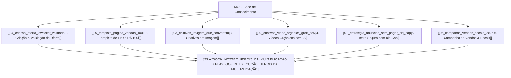

# 🧠 Map of Content (MOC): Sistema de Operação Low-Ticket & Tráfego Pago

Bem-vindo à base de conhecimento centralizada da operação, sintetizada a partir do método de validação, criativos e escala de anúncios do **Guilherme Franklim**.

Esta base foi desenhada no padrão do **Obsidian**, utilizando conexões bidirecionais (`[[link]]`), metadados em frontmatter e checklists de execução direta.

---

## 🗺️ Mapa de Navegação da Base

---

## 📚 Notas Oficiais da Base de Conhecimento

| # | Documento / Nota | Tópico Central | Duração do Vídeo |
| :---: | :--- | :--- | :---: |
| **01** | [[01_estrategia_anuncios_sem_pagar_bid_cap\|Estratégia de Anúncios Sem Pagar (Bid Cap)]] | Como testar criativos no leilão da Meta sem queimar caixa | ~12 min |
| **02** | [[02_criativos_video_organico_grok_flow\|Criativos em Vídeo Orgânico com Grok + Google Flow]] | Produção de vídeos UGC com IA sem precisar de expert | ~19 min |
| **03** | [[03_criativos_imagem_que_convertem\|Criativos em Imagem que Mais Convertem na Prática]] | Os 3 formatos estáticos que batem recorde de CPA baixo | ~14 min |
| **04** | [[04_criacao_oferta_lowticket_validada\|Estratégia Para Criar um Low-Ticket Validado]] | Como criar um MVP irresistível em 24h e testar rápido | ~10 min |
| **05** | [[05_template_pagina_vendas_100k\|Template de Página de Vendas de R$ 100.088 em 30 Dias]] | A anatomia dos 5 blocos da LP que vende no impulso | ~19 min |
| **06** | [[06_campanha_vendas_escala_2026\|Facebook Ads: 1ª Campanha de Vendas para Escalar]] | O "Método Franklin" de escala horizontal e vertical | ~15 min |

---

## ⚡ Guia de Execução da Nossa Oferta Atual

👉 Acesse o plano de batalha consolidado para a oferta da tabuada:  
[[PLAYBOOK_MESTRE_HEROIS_DA_MULTIPLICACAO|🎯 Playbook Mestre: Heróis da Multiplicação (Passo a Passo de Lançamento e Escala)]]
