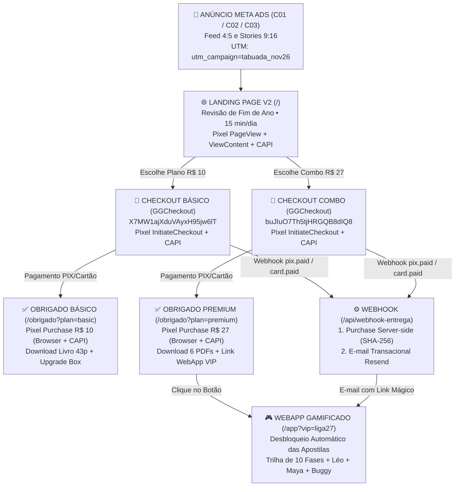

# 🧭 CANVAS DO LANÇAMENTO & FUNIL V2 — HERÓIS DA MULTIPLICAÇÃO

**Operação Comercial V2.1:** Novembro 2026 (Revisão de Fim de Ano)  
**Meta Pixel ID:** `2683241518773685`  
**Conta Meta Ads:** `963451476522179` (CA - XD OFertas)  
**Produção Vercel:** `https://heroisdamultiplicacao.vercel.app/`  
**Orçamento Diário de Teste:** `R$ 30,00/dia`

---

## 1. O CAMINHO COMPLETO DO FUNIL (Passo a Passo Ponta a Ponta)

---

## 2. OS 3 CRIATIVOS DE TESTE (CRIATIVOS, MOCKUPS & COPIES)

### C01 — Alerta Escolar (Editorial / Notícia)
- **Formato Visual:** Visual editorial limpo estilo alerta/capa informativa (alto contraste no feed), texto chamativo + ilustração do Léo segurando o símbolo `×` dourado.
- **Headline no Anúncio:** `Novembro chegou. E a tabuada?`
- **Subtexto na Peça:** *"15 min/dia no papel para o seu filho dominar multiplicação antes das provas finais."*
- **CTA no Anúncio:** `VER MISSÕES DE REVISÃO →`
- **Link com UTMs:** `https://heroisdamultiplicacao.vercel.app/?utm_source=meta&utm_medium=paid_social&utm_campaign=tabuada_nov26&utm_content=C01_alerta_nov&utm_term=alerta_escolar`
- **Copy Principal:**
  > Se o seu filho ainda trava no 7×8 ou chora na hora da lição, a culpa não é dele: decorar a tabuada sem lógica cansa qualquer criança.
  >
  > Com os Heróis da Multiplicação, você imprime em casa uma rotina leve de 15 minutos por dia com missões ilustradas, mapa de conquistas e jogos recortáveis.
  >
  > 👉 Garanta o material completo por R$ 27 (ou plano de entrada por R$ 10) com liberação imediata no PIX ou Cartão.

---

### C02 — Comparação (Split Screen / Antes & Depois)
- **Formato Visual:** Imagem dividida ao meio. Lado A: *Sem Método* (decoreba pesada, estresse na lição de casa). Lado B: *Com os Heróis* (fichas coloridas, jogos de dominó e app interativo no celular).
- **Headline no Anúncio:** `A mesma tabuada. Uma experiência diferente.`
- **Subtexto na Peça:** *"Deixe a decoreba pesada de lado: pratique no papel em 15 min/dia + jogos e desafios no celular."*
- **CTA no Anúncio:** `CONHECER O MATERIAL →`
- **Link com UTMs:** `https://heroisdamultiplicacao.vercel.app/?utm_source=meta&utm_medium=paid_social&utm_campaign=tabuada_nov26&utm_content=C02_comparacao&utm_term=comparacao`
- **Copy Principal:**
  > Tentar forçar a tabuada na repetição só gera estresse na mesa de estudos. Mas quando a matemática vira uma jornada com o Léo, a Maya e o Monstrinho, a criança aprende sem perceber.
  >
  > ✔ Caderno ilustrado do 1 ao 10 em A4  
  > ✔ Jogos de tabuleiro, dominó e bingo  
  > ✔ WebApp estilo jogo no celular sem instalar  
  >
  > 👉 Clique e conheça o material antes do fechamento do ano letivo.

---

### C03 — Oferta Direta do Combo (Apresentação Comercial)
- **Formato Visual:** Capas oficiais dos cadernos + Léo e Maya + selo de preço **R$ 27,00** (pagamento único) + lista curta dos 6 entregáveis.
- **Headline no Anúncio:** `Transforme a tabuada em missões de herói`
- **Subtexto na Peça:** *"Combo Liga dos Heróis: 6 apostilas em PDF A4 + Jogos + WebApp por R$ 27."*
- **CTA no Anúncio:** `QUERO POR R$ 27 →`
- **Link com UTMs:** `https://heroisdamultiplicacao.vercel.app/?utm_source=meta&utm_medium=paid_social&utm_campaign=tabuada_nov26&utm_content=C03_oferta_combo27&utm_term=oferta_direta`
- **Copy Principal:**
  > Tudo o que seu filho precisa para dominar a tabuada do 1 ao 10 reunido em um único material prático para imprimir:
  >
  > 1️⃣ Livro Completo Missão Tabuada (43 pág.)  
  > 2️⃣ Cronograma de 12 Semanas  
  > 3️⃣ Caderno de Fichas Diárias  
  > 4️⃣ Caderno de Pintura por Contas  
  > 5️⃣ Jogos de Tabuleiro e Bingo  
  > 6️⃣ WebApp interativo com fases e mascotes  
  >
  > 👉 De R$ 97 por apenas R$ 27 (pagamento único). Clique e baixe agora!

---

## 3. ESTRUTURA DA CAMPANHA BID CAP (R$ 30/DIA)

### Por que Bid Cap?
O **Bid Cap (Limite de Lance)** define o valor máximo que você autoriza o Meta a pagar por uma compra (`Purchase`). Isso impede que a plataforma pague lances abusivos quando o leilão estiver concorrido, blindando a margem do produto de ticket baixo (R$ 27).

### Cálculo de Equilíbrio (Break-Even):
$$\text{Recebimento Líquido} = \text{Preço do Combo (R\$ 27,00)} - \text{Taxa Gateway/Plataforma (~R\$ 2,80)} = \text{R\$ 24,20}$$
$$\text{Com 1 Order Bump (R\$ 36,90)} = \text{R\$ 36,90} - \text{Taxas (~R\$ 3,50)} = \text{R\$ 33,40}$$

### Tabela de Configuração Recomendada:
| Item | Configuração no Gerenciador de Anúncios |
| :--- | :--- |
| **Nome da Campanha** | `[V2] HERÓIS DA MULTIPLICAÇÃO — CONVERSÕES (BID CAP)` |
| **Objetivo (ODAX)** | `Vendas` (`OUTCOME_SALES`) |
| **Estratégia de Lance** | `Limite de Lance` (`Bid Cap`) |
| **Valor do Bid Cap** | **`R$ 22,00`** *(ou R$ 25,00 para garantir que o leilão entregue)* |
| **Orçamento** | **`R$ 30,00 / dia`** (CBO / Orçamento de Campanha Advantage) |
| **Público** | Brasil • Idade: 28 a 52 anos • Pais e Mães (ou Advantage+ Audience) |
| **Posicionamentos** | Advantage+ Placements (Feed Instagram/Facebook, Stories e Reels) |
| **Pixel & Evento** | Pixel `2683241518773685` • Evento: `Comprar` (`Purchase`) |
| **Status Inicial** | **PAUSADO / RASCUNHO** |

> [!TIP]
> **Dica Operacional de Entrega:** Se a campanha ficar com **0 impressões** após 24h, significa que o leilão do dia está exigindo lances maiores que R$ 22,00. Nesse caso, aumente o Bid Cap para R$ 25,00 ou mude temporariamente para **Maior Volume** por 48 horas para registrar as primeiras vendas e calibrar o algoritmo.

---

## 4. CHECKLIST DE RASTREAMENTO E INTEGRAÇÃO

1. **Pixel de Navegador:** Carregado em `index.html` e `obrigado.html` disparando `PageView`, `ViewContent`, `InitiateCheckout` e `Purchase`.
2. **Meta CAPI Serverless:** Rota `POST /api/meta-capi` respondendo `200 OK` (`{"success":true,"skipped":false,"events_received":1}`).
3. **Webhook GGCheckout:** Rota `POST /api/webhook-entrega` disparando `Purchase` server-side com dados do comprador hasheados (SHA-256) e e-mail transacional via Resend.
4. **Desbloqueio VIP do WebApp:** Link `/app?vip=liga27` na página de obrigado liberando as 6 apostilas em PDF instantaneamente no navegador do comprador.
